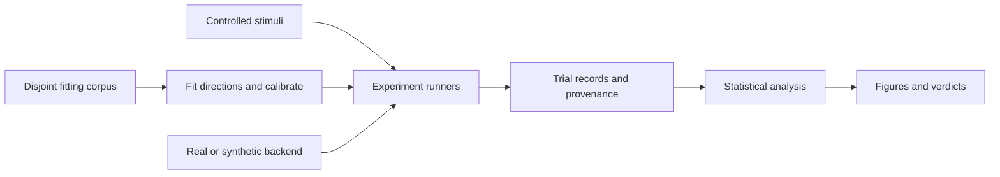

# J-space Binding Experiments

[](https://github.com/Festyve/jspace-binding-experiments/actions/workflows/ci.yml)
[](pyproject.toml)
[](LICENSE)

An experimental framework for studying how language models represent **who did
what to whom**: controlled stimuli, activation probes, causal interventions,
and reproducible statistical analysis across Qwen and Gemma models.

> **Paper repository:** [A Bag of Concepts? Testing Role-Filler Binding in the
> Verbalizable Workspace](https://github.com/Reyadawlah/role-filler-binding-jspace).
> This repository preserves the research implementation and experiment history
> developed for that work. It remains public as a record of the technical work;
> use the paper repository for paper-specific reproduction instructions.

**Explore:** [Architecture](docs/ARCHITECTURE.md) · [Results](RESULTS.md) ·
[GPU runbook](RUNBOOK.md) · [Tests](tests/)

## The research question

A model that reads *The doctor treated the lawyer* can recognize both
professions. Representing which person acted is a different problem:
**role–filler binding**. This project tests whether the J-lens's sparse
concept workspace also supports that binding.

| Experiment | Question | Approach |
|---|---|---|
| RQ1 — decoding | Can role information be read from J-space? | Leave-one-pair-out ridge probes over J-space, the residual stream, its orthogonal complement, and a rank-matched random subspace |
| RQ2 — ablation | Does the model use J-space for binding? | J-space ablation versus a rank-matched random subspace, with a concept-recall control |
| E3 — steering | Can a role direction change binding? | Push fitted role directions in both signs, with non-participant, random, and shuffled-label controls |
| E4 — recruitment | Does asking about a role change its representation? | Compare role and neutral questions at the final token of the full prompt |

## Engineering highlights

| Component | Implementation | Start reading |
|---|---|---|
| Controlled datasets | Role × word-order counterbalancing across four syntactic constructions; separate fitting, primary, and evaluation corpora with disjointness checks | [Stimulus templates](src/jspace_binding/stimuli/templates.py), [corpus checks](src/jspace_binding/stimuli/qc.py) |
| Model abstraction | Shared protocols for experiments, a synthetic backend with known answers, and a real backend for lens loading, sparse pursuit, and activation edits | [Backend protocols](src/jspace_binding/model/base.py), [real backend](src/jspace_binding/model/qwen_jlens.py) |
| Direction fitting and intervention | Difference-of-means and gradient estimators, bootstrap stability, calibrated push strengths, and controls for intervention specificity | [Direction fitting](src/jspace_binding/directions/fit.py), [edit specifications](src/jspace_binding/interventions/edits.py) |
| Statistical analysis | Log-odds crossover scores, bootstrap confidence intervals, sign-flip permutation tests, effect sizes, and Holm correction | [Binding score](src/jspace_binding/analysis/binding_score.py), [statistics](src/jspace_binding/analysis/stats.py) |
| Validation and provenance | Ground-truth recovery tests, preflight checks, run metadata, compressed trial archives, and CPU-only verdict re-scoring | [Pipeline tests](tests/test_pipeline.py), [provenance](src/jspace_binding/experiments/provenance.py), [archive re-scoring](scripts/reanalyze_primary.py) |

The pipeline separates model execution from analysis. Experiments use the
`WorkspaceModel` protocol, so the same experiment and scoring code can run
against real model activations or the GPU-free `DummyModel`.



See [ARCHITECTURE.md](docs/ARCHITECTURE.md) for the scoring equations, module
contracts, and design decisions. Contributor attribution is recorded in the
[commit history](https://github.com/Festyve/jspace-binding-experiments/commits/main/) and source credits.

## Run locally — no GPU required

Use **Python 3.10 or newer**. The base installation needs no model weights or
PyTorch; CI uses Python 3.12.

```bash
git clone https://github.com/Festyve/jspace-binding-experiments.git
cd jspace-binding-experiments
python3 -m venv .venv
source .venv/bin/activate
python -m pip install -e '.[dev]'
python -m pytest -q
```

On Windows, activate with `.venv\Scripts\Activate.ps1` in PowerShell instead.

Run the small end-to-end configuration:

```bash
python scripts/fit_directions.py --config configs/ci.yaml --dry-run
python scripts/calibrate.py --config configs/ci.yaml --dry-run
python scripts/run_primary.py --config configs/ci.yaml --dry-run --dummy-mode binding
python scripts/run_primary.py --config configs/ci.yaml --dry-run --dummy-mode bag
```

The synthetic `binding` mode plants a positive binding signal; `bag` plants a
role-independent effect whose binding score should remain near zero. The
[pipeline tests](tests/test_pipeline.py) assert both outcomes against the
control null band. These runs validate the pipeline; they are not measurements
of a language model. CI outputs use separate paths, including
`data/results_ci/` and `figures_ci/`; successive runs reuse those paths.

The secondary analyses also run locally:

```bash
python scripts/run_rq1.py --config configs/ci.yaml --dry-run
python scripts/run_rq2.py --config configs/ci.yaml --dry-run
python scripts/run_e4.py --config configs/ci.yaml --dry-run
```

To exercise real model loading and edit hooks on a small model with a synthetic
identity-Jacobian lens (downloads model weights):

```bash
python -m pip install -e '.[model]'
python scripts/smoke_test.py --model-id Qwen/Qwen2.5-0.5B
```

For the full experiments, hardware requirements, calibration, and run order,
see the [GPU runbook](RUNBOOK.md).

## Results at a glance

The archived experiments cover **Qwen3.6-27B**, **Gemma-3-12B**, and
**Gemma-3-27B-IT**. They distinguish information being *decodable* from a
representation from that representation being *causally used* for binding.

- **Decoding:** in Qwen's within-pair, final-token analysis, residual-stream
  accuracy is **0.989**, versus **0.587** in J-space and **0.643** in the
  rank-matched random subspace. This is a within-pair result; cross-pair transfer
  is a separate test and often inverts. Random-control comparisons vary by
  model and layer.
- **Ablation:** Qwen and Gemma-3-12B show no binding deficit. Gemma-3-27B-IT
  shows a deficit of **0.284** of baseline margin (**0.275** after subtracting
  the recall deficit), with the effect also observed under two other lenses.
  Scale and instruction tuning remain confounded in this comparison.
- **Steering:** no tested model shows a binding-specific push effect. Failed
  intervention-strength checks limit which null results are interpretable.

[RESULTS.md](RESULTS.md) indexes the authoritative artifacts and explains the
controls, limitations, and verdict rules. It contains the detailed Qwen record
and points to the Gemma run notes. Read it before quoting an archived summary:
some saved verdict labels predate the current analysis rules.

### Re-score archived experiments on a CPU

```bash
python scripts/reanalyze_rq2.py --all
python scripts/reanalyze_primary.py --run runs/gemma3-12b-lre --site entity_token
```

These commands use saved measurements without downloading models or rerunning
forward passes. They exit 1 if the compared archived verdict disagrees with the
current rule. Inspect `provenance`, intervention-strength checks, and
`null_interpretable` alongside the headline outcome.

For the Gemma-3-12B example above, exit 1 is expected: the saved label is
`significant_but_tiny`, while the current rule returns
`indistinguishable_from_controls`, as recorded in [RESULTS.md](RESULTS.md).
The re-scoring command leaves the archived trial records unchanged.

## Repository map

| Path | Contents |
|---|---|
| [`src/jspace_binding/`](src/jspace_binding/) | Stimuli, model backends, direction fitting, interventions, experiments, and analysis |
| [`scripts/`](scripts/) | Command-line entry points and robustness checks |
| [`configs/`](configs/) | Model, lens, estimator, and small CI configurations |
| [`tests/`](tests/) | Unit tests, regression tests, and end-to-end synthetic validation |
| [`data/`](data/) | Curated corpora and reviewable stimulus CSVs; generated outputs are ignored |
| [`runs/`](runs/) | Archived experiment artifacts, indexed by [RESULTS.md](RESULTS.md) |
| [`docs/`](docs/) | Architecture, concept-probe design, and NLA scoping notes |

## License

[MIT](LICENSE). For the paper and its reproduction instructions, use the
[paper repository](https://github.com/Reyadawlah/role-filler-binding-jspace).
When referencing an experiment from this repository, include its commit and
the artifact identified in [RESULTS.md](RESULTS.md).
